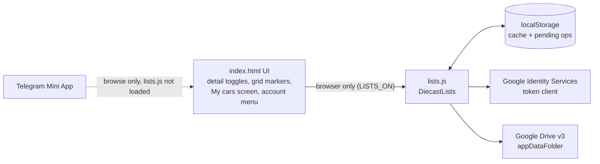

# Design: My Collection & Wishlist

## Overview

Everything stays client-side, in keeping with the rest of the app: plain
ES5-style JavaScript, no build step, hosted on GitHub Pages. The new code goes
into a new file, **`lists.js`**, which exposes `window.DiecastLists`. Keeping
it separate means `index.html` (already about 3,000 lines) only gains the UI
glue, and the sync logic can be read and tested on its own.

**Browser only.** The feature is turned on by one flag, `LISTS_ON =
!isTelegram`, computed right after the existing Telegram check. When
`LISTS_ON` is false (Telegram Mini App):

- `lists.js` and the Google script are never loaded, and no request goes to
  Google.
- The account button, the detail toggles, the grid markers, the Owned/Wanted
  pills and the My cars overlay are never added to the page. Every UI hook
  below starts with `if (!LISTS_ON) return;` or checks `LISTS_ON` before
  adding markup.
- The app behaves exactly as it does today.

When `LISTS_ON` is true, `index.html` adds a `<script src="./lists.js">` tag
at startup, the same way it loads Lottie. On `load` it calls
`DiecastLists.init()`. The first `change` event re-renders the grid with the
owned/wanted markers, so the catalog never waits for the lists to load.



## Choosing where to store the data

The feature is browser-only, so Telegram storage isn't needed.

| Option | Data stays in the user's account | Works on GitHub Pages | Notes |
|---|---|---|---|
| **Drive `appDataFolder`** (chosen) | Yes | Yes | Non-sensitive scope, so no Google review. Hidden from the user's Drive list and from other apps. |
| Drive `drive.file` (visible file) | Yes | Yes | Users can see and edit the file, and an edit can break it. Needs the Picker to reopen the file on a new device. |
| Google Sheets | Yes | Yes | Sensitive scope, which needs Google verification. |
| Firebase / Supabase | No (stored on our project) | Yes | Breaks the rule that we store nothing. |
| localStorage only | Device only | Yes | Lost when the browser data is cleared, and doesn't sync. Used only as a cache. |

## Authentication (browser)

- **Library:** Google Identity Services (GIS) token model,
  `https://accounts.google.com/gsi/client`, loaded on demand the first time
  sign-in is needed or a stored session exists. Google doesn't publish
  versioned builds of this script, so it can't be pinned with an SRI hash.
  The docs will note this, as they already do for the Telegram script.
- **Client:** `google.accounts.oauth2.initTokenClient({ client_id, scope:
  "https://www.googleapis.com/auth/drive.appdata", callback })`. The client ID
  is public and goes in a constant near the top of `lists.js`
  (`GOOGLE_CLIENT_ID`).
- **Tokens:** access tokens last about an hour. Without a backend there are no
  refresh tokens. The token and its expiry are kept in memory and mirrored to
  `sessionStorage`, so a reload in the same tab doesn't need a popup.
  `localStorage` only keeps a `signedIn: true` hint and the email (the hint
  passed to GIS).
- **Renewal:** `ensureToken(interactive)`.
  - If the token is still valid for at least 2 more minutes, use it.
  - Otherwise, when called from a user gesture, call
    `tokenClient.requestAccessToken({ prompt: "", hint: email })`. For a user
    who already consented, the popup closes on its own.
  - Without a gesture (app start, tab visible), skip the network sync. Show
    the cached lists and set the state to *Not synced (tap to sync)*.
- **Sign out:** `google.accounts.oauth2.revoke(token)`, then clear the
  sessionStorage token, the localStorage cache and the hint.
- **Who's signed in:** `GET https://www.googleapis.com/drive/v3/about?fields=user(displayName,emailAddress,photoLink)`.
  The `drive.appdata` scope is enough for this call, so no `profile` or
  `email` scopes are needed.

### Google Cloud setup (one-time, by the repo owner)

1. Create a Google Cloud project and enable the **Google Drive API**.
2. Set up the OAuth consent screen: type External, app name "diecastDb",
   scope `.../auth/drive.appdata`, privacy policy URL
   `https://danyjoy.github.io/diecastDb/privacy.html`. Publish it to
   **In production**. In *Testing*, only listed test users can sign in and
   tokens expire after 7 days.
3. Create an OAuth client of type *Web application*. Authorised JavaScript
   origins: `https://danyjoy.github.io` and `http://localhost:8000`.
   Redirect URIs aren't needed with the popup token flow.
4. Put the client ID in `GOOGLE_CLIENT_ID`.

## Data model

One JSON document, stored as `diecastdb-lists.json` in the Drive app data
folder:

```json
{
  "app": "diecastDb",
  "version": 1,
  "updated_at": "2026-10-30T12:00:00.000Z",
  "collection": {
    "JBB06_1": { "y": "2025", "a": "mainline", "t": "'15 LAND ROVER DEFENDER DOUBLE CAB", "at": 1793361600000 }
  },
  "wishlist": {
    "HTX12_2": { "y": "2026", "a": "premium", "t": "NISSAN SKYLINE GT-R", "at": 1793361600000 }
  },
  "removed": {
    "collection": { "ABC12_1": 1793361700000 },
    "wishlist": {}
  }
}
```

- The keys are catalog `id`s. `y` (year) and `a` (collection key) are what
  "open this car" needs to call `loadCollection(a, y)`. `t` (title) lets the
  My cars screen show a name even before the scan index loads, or after a car
  disappears from the catalog.
- `at` is the time the car was added (ms). `removed` holds tombstones (time
  of removal), so that merging two devices doesn't bring back a car that was
  deleted. Tombstones older than 90 days are dropped on save.
- Size: about 90 bytes per entry, so 5,000 cars come to about 450 KB.

### Local cache (`localStorage`)

| Key | Value |
|---|---|
| `dl.lists` | The last-known document (JSON above). |
| `dl.pending` | Ordered list of ops not yet saved: `{op: "add"\|"remove", list, id, y, a, t, at}`. |
| `dl.hint` | Google email, used as the GIS login hint. Not a secret. |

The cache is cleared on sign-out.

## Sync algorithm

```
save():                         // queued; only one runs at a time
  if no pending ops: return
  state = "syncing"
  remote = drive.read()         // null if there's no file yet
  if remote unparseable: state = "error"; stop (never overwrite)
  doc = merge(remote || empty, local)
  apply pending ops to doc (add: put entry, delete tombstone;
                            remove: delete entry, add tombstone)
  drive.write(doc)
  local = doc; pending = []; state = "synced"

merge(a, b):                    // used on start, on visibility change, and in save
  for each list, for each id in a ∪ b:
     added   = latest "at" of either side
     removed = latest tombstone of either side
     keep the entry if added > removed
```

- **Have it** removes the car from Wishlist in the same batch (Req 3.3).
- Saves are debounced by 800 ms, so tapping several toggles quickly makes one
  write.
- Failures (offline, 5xx, 401 without a gesture) leave the ops in
  `dl.pending`. They are retried on the next toggle, Sync now, app start, or
  the `online` event.
- On 401, drop the token and set the state to "Not synced (tap to sync)".
  The next tap gets a new token.
- Drive has no compare-and-swap on media uploads, so two devices saving in
  the same second can still race. Re-reading before every write and keeping
  tombstones makes the race window small. For a personal list that's
  acceptable.

## Drive API calls

| Purpose | Request |
|---|---|
| Find the file | `GET /drive/v3/files?spaces=appDataFolder&q=name='diecastdb-lists.json'&fields=files(id)` |
| Read | `GET /drive/v3/files/{id}?alt=media` |
| Create | `POST /upload/drive/v3/files?uploadType=multipart`, metadata `{name, parents:["appDataFolder"], mimeType:"application/json"}` |
| Update | `PATCH /upload/drive/v3/files/{id}?uploadType=media` |
| Delete (Delete my data) | `DELETE /drive/v3/files/{id}` |

All requests go to `https://www.googleapis.com` with `Authorization: Bearer`.
The file id is kept in memory after the first lookup.

## `lists.js` public API

```js
DiecastLists.init()                    // browser mode only: loads the cache, starts a background pull
DiecastLists.has(list, id)             // -> boolean   (list: "collection" | "wishlist")
DiecastLists.toggle(list, car)         // must be called from a click; may open the Google popup
DiecastLists.entries(list)             // -> [{id, y, a, t, at}], newest year first
DiecastLists.counts()                  // -> {collection, wishlist}
DiecastLists.signIn() / signOut()
DiecastLists.syncNow()
DiecastLists.exportJSON()              // -> Blob
DiecastLists.deleteAll()               // removes the Drive file and the cache
DiecastLists.user()                    // -> {name, email, photo} | null
DiecastLists.state()                   // "signed-out" | "synced" | "syncing" | "offline" | "error"
DiecastLists.on("change", fn)          // fired when the lists or the sync state change
```

`toggle` updates the cache and fires `change` straight away (optimistic),
then schedules `save()`. If the user is signed out, it calls
`signIn()` first and only applies the toggle once sign-in succeeds (Req 3.4).

## UI changes (`index.html`)

None of this is added in Telegram mode (`LISTS_ON` is false).

- **Header:** an account button in `.titlebar`, on the right. Signed out it
  shows a person icon. Signed in it shows the user's initial or photo. A
  small dot shows the sync state (amber when unsynced, red on error).
- **Account sheet** (a bottom sheet, z-index 30, reusing the `.sheet`
  styles):
  - Signed out: "Sign in with Google", plus one line explaining that data
    is saved in your own Google Drive and that we never see it, with a link
    to the privacy page.
  - Signed in: name and email, sync state, **My cars**, **Sync now**,
    **Export**, **Delete my data**, **Sign out**.
- **Detail view:** a row of two pill toggles under the title/subhead, before
  the specs: **✓ Have it** and **♡ Want it**, with `aria-pressed`. They are
  rebuilt in `showDetail` and refreshed on `change`.
- **Grid cards:** a small corner marker (✓ green for owned, ♡ for wanted) at
  the bottom-left of `.thumb`, so it doesn't collide with the rarity badge at
  the top. Added in `render()` from `DiecastLists.has`.
- **Filters:** when either list has entries, **Owned** and **Wanted** pills
  appear after the rarity pills. They join `matches()` as an `ownFilter`
  (`null | "owned" | "wanted"`), combined with the other filters using AND.
- **My cars screen** (`#mycars`): a full-screen overlay at **z-index 18**,
  below the detail view (20). Tapping a car opens the detail on top, and Back
  returns to My cars, the same way the grid works. It has tabs, a search box
  and rows built like scanner result rows (`.scanrow` styles: thumbnail, title,
  meta, tags). Thumbnails use the known URL pattern
  `https://findmyhw.com/media/images/<id>/<id>_1.webp`. The rows come from
  `entries()`. When `data/scan-index.json` is already loaded, it supplies the
  series, rarity and image flag, and marks ids that are no longer in the
  catalog.
- **Opening a car from My cars:** the same pattern as `openScanMatch`: if
  `curAssort`/`curYear` differ, `loadCollection(a, y)`, find the car by id,
  and `showDetail(car)` (pushing a history entry, since My cars stays open
  underneath).
- **History / back:** opening My cars pushes `{ mycars: true }`. The
  `popstate` order becomes zoom → scanner → detail → account sheet →
  My cars. (Telegram's BackButton isn't involved, because none of this
  exists in Telegram mode.)
- **Layer order** (update docs/development.md): header 10, go-to-top 15,
  My cars 18, detail 20, sheets 30, scanner 35, zoom 40.

## Security and privacy

- Least privilege: only `drive.appdata`. The app can't see any other Drive
  file.
- The token lives in memory and `sessionStorage` only. It's never logged or
  put in a URL, and it's revoked on sign-out.
- Stored titles go through `esc()` before rendering, like all catalog text,
  because the remote file is user-controlled data.
- Validate the document on read. Keep only ids that match
  `/^[A-Za-z0-9_-]{1,40}$/` and years that match `/^\d{4}$/`, and only
  collection keys that are known in the manifest or are short slugs. Drop
  anything else.
- No new third parties except Google (`accounts.google.com`,
  `www.googleapis.com`). Update the "External services" table and the CSP
  note in docs/development.md.
- New `privacy.html`: what is stored (car ids, year, collection, title, time
  added), where (your Drive app data folder), that we have no server, that
  the Telegram Mini App doesn't use this feature, and how to delete it
  (Delete my data, or Drive → Settings → Manage apps → diecastDb → Delete
  hidden app data).

## Error handling

| Case | Behaviour |
|---|---|
| Popup blocked or closed | Toast: "Sign-in was cancelled." The state stays the same. |
| Site opened in an in-app browser (a link tapped in Telegram chat, Instagram, …) | This counts as browser mode, but Google refuses the sign-in (`disallowed_useragent`). When GIS reports a popup or sign-in failure, the sheet says "Google sign-in doesn't work in in-app browsers. Open the site in Chrome or Safari." |
| Offline | Ops stay queued, the dot turns amber, retry on the `online` event. |
| 401 / expired token | Drop the token. The next gesture re-authorises. |
| 403 (Drive API disabled, quota) | State *error*. The menu shows the message. Ops are kept. |
| Remote file not valid JSON / unknown version | Stop syncing and don't overwrite. The menu says "Your saved list couldn't be read" and offers Export of the local copy. |

## Testing

There is no test framework in the repo, so testing is manual (per the
project's conventions). The checks:

- Browser on localhost: sign in, toggle, reload (no popup within the hour),
  sign out (the cache is cleared).
- Two browsers or profiles with the same account: add on A, focus B, and the
  car shows up. Remove on B, then add something else on A, and the removal
  isn't undone.
- Offline toggle (DevTools → Offline), then back online: it syncs.
- Telegram (deployed site): no account button, toggles, markers, Owned /
  Wanted pills or My cars. In DevTools / remote debugging, there are no
  requests to `accounts.google.com` or `googleapis.com`, and `lists.js` isn't
  fetched. Browsing, the scanner and the detail view work as before.
- Drive → Manage apps shows "diecastDb" with hidden app data, and Delete
  removes it.
